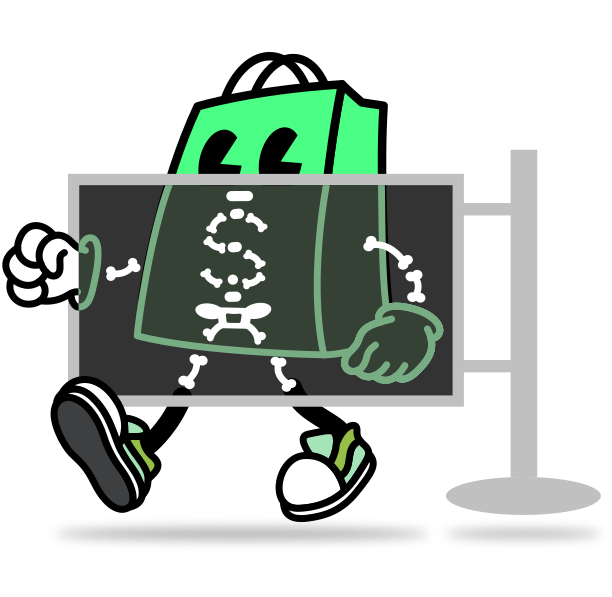

<h1 align="center" style="position: relative;">
  <br>
    
  <br>
  Shopify Skeleton Theme
</h1>

A minimal, carefully structured Shopify theme designed to help you quickly get started. Designed with modularity, maintainability, and Shopify's best practices in mind.

<p align="center">
  <a href="./LICENSE.md"></a>
  <a href="./actions/workflows/ci.yml"></a>
</p>

## Getting started

### Prerequisites

Before starting, ensure you have the latest Shopify CLI installed:

- [Shopify CLI](https://shopify.dev/docs/api/shopify-cli) – helps you download, upload, preview themes, and streamline your workflows

If you use VS Code:

- [Shopify Liquid VS Code Extension](https://shopify.dev/docs/storefronts/themes/tools/shopify-liquid-vscode) – provides syntax highlighting, linting, inline documentation, and auto-completion specifically designed for Liquid templates

### Clone

Clone this repository using Git or Shopify CLI:

```bash
git clone git@github.com:Shopify/skeleton-theme.git
# or
shopify theme init
```

### Preview

Preview this theme using Shopify CLI:

```bash
shopify theme dev
```

## Theme architecture

```bash
.
├── assets          # Stores static assets (CSS, JS, images, fonts, etc.)
├── blocks          # Reusable, nestable, customizable UI components
├── config          # Global theme settings and customization options
├── layout          # Top-level wrappers for pages (layout templates)
├── locales         # Translation files for theme internationalization
├── sections        # Modular full-width page components
├── snippets        # Reusable Liquid code or HTML fragments
└── templates       # Templates combining sections to define page structures
```

To learn more, refer to the [theme architecture documentation](https://shopify.dev/docs/storefronts/themes/architecture).

### Templates

[Templates](https://shopify.dev/docs/storefronts/themes/architecture/templates#template-types) control what's rendered on each type of page in a theme.

The Skeleton Theme scaffolds [JSON templates](https://shopify.dev/docs/storefronts/themes/architecture/templates/json-templates) to make it easy for merchants to customize their store.

None of the template types are required, and not all of them are included in the Skeleton Theme. Refer to the [template types reference](https://shopify.dev/docs/storefronts/themes/architecture/templates#template-types) for a full list.

### Sections

[Sections](https://shopify.dev/docs/storefronts/themes/architecture/sections) are Liquid files that allow you to create reusable modules of content that can be customized by merchants. They can also include blocks which allow merchants to add, remove, and reorder content within a section.

Sections are made customizable by including a `` in the body. For more information, refer to the [section schema documentation](https://shopify.dev/docs/storefronts/themes/architecture/sections/section-schema).

### Blocks

[Blocks](https://shopify.dev/docs/storefronts/themes/architecture/blocks) let developers create flexible layouts by breaking down sections into smaller, reusable pieces of Liquid. Each block has its own set of settings, and can be added, removed, and reordered within a section.

Blocks are made customizable by including a `` in the body. For more information, refer to the [block schema documentation](https://shopify.dev/docs/storefronts/themes/architecture/blocks/theme-blocks/schema).

## Schemas

When developing components defined by schema settings, we recommend these guidelines to simplify your code:

- **Single property settings**: For settings that correspond to a single CSS property, use CSS variables:

  ```liquid
  <div class="collection" style="--gap: {{ block.settings.gap }}px">
    ...
  </div>

  
    .collection {
      gap: var(--gap);
    }
  

  
  {
    "settings": [{
      "type": "range",
      "label": "gap",
      "id": "gap",
      "min": 0,
      "max": 100,
      "unit": "px",
      "default": 0,
    }]
  }
  
  ```

- **Multiple property settings**: For settings that control multiple CSS properties, use CSS classes:

  ```liquid
  <div class="collection {{ block.settings.layout }}">
    ...
  </div>

  
    .collection--full-width {
      /* multiple styles */
    }
    .collection--narrow {
      /* multiple styles */
    }
  

  
  {
    "settings": [{
      "type": "select",
      "id": "layout",
      "label": "layout",
      "values": [
        { "value": "collection--full-width", "label": "t:options.full" },
        { "value": "collection--narrow", "label": "t:options.narrow" }
      ]
    }]
  }
  
  ```

## CSS & JavaScript

For CSS and JavaScript, we recommend using the [``](https://shopify.dev/docs/api/liquid/tags#stylesheet) and [``](https://shopify.dev/docs/api/liquid/tags/javascript) tags. They can be included multiple times, but the code will only appear once.

### `critical.css`

The Skeleton Theme explicitly separates essential CSS necessary for every page into a dedicated `critical.css` file.

## Contributing

We're excited for your contributions to the Skeleton Theme! This repository aims to remain as lean, lightweight, and fundamental as possible, and we kindly ask your contributions to align with this intention.

Visit our [CONTRIBUTING.md](./CONTRIBUTING.md) for a detailed overview of our process, guidelines, and recommendations.

## License

Skeleton Theme is open-sourced under the [MIT](./LICENSE.md) License.

## Section list: 
 
Wavy marquee
 
Vertical carousel
 
Trending products
 
Text with icon 
 
Testimonals
 
Sticky media cards
 
Social media gallery
 
Slideshow with marquee
 
Shop the kit
 
Scrolling text
 
Scrolling media cards
 
Scrollable marquee
 
Scrollable Collection
 
Scroll Slides
 
Products grid
 
Pairing Products
 
Multicolumn
 
Mix & match pack
 
Media with text overlay
 
Media with text
 
Media with cards
 
Media grid
 
Map
 
Lookbook
 
Images with text carousel
 
Images comparison
 
Highlight Text with Images
 
Hero Carousel
 
Featured products
 
Featured collections tabs
 
Detailed contact form
 
Collection with products
 
Collection tabs
 
Collection carousel
 
Burst effects
 
Blog posts
 
Best selling products
 
Custom Liquid
 
Newsletter
 
Collapsible content
 
Rich text
 
Collection list
 
Featured product

Featured collection

## Pending features 

1 Faceted search filtering — required on collection and search pages (price, availability, vendor, variant). Not present at all; only basic sorting exists.
2 Unit pricing — required on product, collection, cart, and customer pages. Not implemented anywhere.
3 Product swatches — variant picker uses plain text/radio buttons; Theme Store requires visual swatches via swatch.color/swatch.image.
4 Accelerated checkout buttons on Cart page — you have it on product page; cart page has none.
5 Selling plans (subscriptions) — required on cart and customer pages. Not present.
6 Shop Pay Installments — required on product page. Not present.
7 Pickup availability — required on product page. Not present.
8 Real product recommendations — required via Shopify's actual recommendations object/API on product pages. pairing-products.liquid is merchant-curated, not the automated recommendation feature — doesn't satisfy this.
9 Follow on Shop button (login_button filter) — not present.
10 App block support (@app) in main-product and featured-product sections — not present; you have concrete block types only.
12 Color system — only 2 color settings (background/foreground) in settings_schema.json; requirement is minimum 4, each background paired with a foreground, in all sections and css files make dynamic in theme settings.
13 Favicon setting — not present in settings_schema.json.
14 Placeholder social URLs (.../#) — explicitly against the "must be left empty" / no-fake-content rule; needs fixing before any submission regardless.
15 SEO structured data (Google rich product snippets / JSON-LD) — meta-tags.liquid never reviewed, can't confirm this exists. (already fixed)
16 page.contact.json — required template; currently doesn't exist properly (we established you have no Contact page set up).
17 test all theme settings
--done above--
18 image on collection page and products in collections. 
19 Improve lighthouse score with sections present. (after all improvements done.)
20 Update README.md with your own branding + usage instructions.
21 Consider adding a clear commercial license in LICENSE.md.
22 Remove/replace/ all images with watermark of website name, product images 1:1.
23 product category, to search relevant products, like hat? (check shopify requirements)
24 Collection top image, ratio, check later. 
25 Add one product to each 20+ collections. 
26 Work on it at end: 
Default setting values for section and block content should indicate how to use the setting. Don't use Lorem Ipsum text or demo store content as a placeholder. 
(Leave demo store different from theme to submit.)
1. settings_schema.json (Full Updated File)
json
[
  {
    "name": "theme_info",
    "theme_name": "Suvara",
    "theme_version": "0.1.0",
    "theme_author": "Caresort Technologies",
    "theme_documentation_url": "https://help.shopify.com/manual/online-store/themes",
    "theme_support_url": "https://support.shopify.com/"
  },
  {
    "name": "t:general.typography",
    "settings": [
      {
        "type": "header",
        "content": "t:general.fonts"
      },
      {
        "type": "font_picker",
        "id": "type_primary_font",
        "default": "work_sans_n4",
        "label": "t:general.primary"
      }
    ]
  },
  {
    "name": "t:general.layout",
    "settings": [
      {
        "type": "select",
        "id": "max_page_width",
        "label": "t:labels.page_width",
        "options": [
          {
            "value": "90rem",
            "label": "t:options.page_width.narrow"
          },
          {
            "value": "110rem",
            "label": "t:options.page_width.wide"
          }
        ],
        "default": "90rem"
      },
      {
        "type": "range",
        "id": "min_page_margin",
        "min": 10,
        "max": 100,
        "step": 1,
        "unit": "px",
        "label": "t:labels.page_margin",
        "default": 20
      }
    ]
  },
  {
    "name": "t:general.favicon",
    "settings": [
      {
        "type": "image_picker",
        "id": "favicon",
        "label": "t:labels.favicon",
        "info": "t:info.favicon"
      }
    ]
  },
  {
    "name": "t:general.colors",
    "settings": [
      {
        "type": "header",
        "content": "Primary colors"
      },
      {
        "type": "color",
        "id": "background_color",
        "default": "#FFFFFF",
        "label": "t:labels.background"
      },
      {
        "type": "color",
        "id": "foreground_color",
        "default": "#333333",
        "label": "t:labels.foreground"
      },

      {
        "type": "header",
        "content": "Secondary colors"
      },
      {
        "type": "color",
        "id": "background_color_secondary",
        "default": "#F5F5F5",
        "label": "Secondary background"
      },
      {
        "type": "color",
        "id": "foreground_color_secondary",
        "default": "#1A1A1A",
        "label": "Secondary foreground"
      },

      {
        "type": "header",
        "content": "Accent / Buttons"
      },
      {
        "type": "color",
        "id": "accent_background",
        "default": "#121212",
        "label": "Accent background"
      },
      {
        "type": "color",
        "id": "accent_foreground",
        "default": "#FFFFFF",
        "label": "Accent foreground"
      },
      {
        "type": "range",
        "id": "input_corner_radius",
        "min": 0,
        "max": 50,
        "step": 1,
        "unit": "px",
        "label": "t:labels.input_corner_radius",
        "default": 4
      },

      {
        "type": "header",
        "content": "Status colors"
      },
      {
        "type": "color",
        "id": "color_sale",
        "default": "#c62828",
        "label": "Sale color",
        "info": "Used for sale badges and discount prices."
      },
      {
        "type": "color",
        "id": "color_sold_out",
        "default": "#767676",
        "label": "Sold-out color",
        "info": "Used for sold-out badges and unavailable products."
      },
      {
        "type": "color",
        "id": "color_success",
        "default": "#2e7d32",
        "label": "Success color",
        "info": "Used for success messages and valid form fields."
      },
      {
        "type": "color",
        "id": "color_success_bg",
        "default": "#e6f4ea",
        "label": "Success background",
        "info": "Background color for success messages."
      },
      {
        "type": "color",
        "id": "color_success_text",
        "default": "#1e4620",
        "label": "Success text color",
        "info": "Text color for success messages."
      },
      {
        "type": "color",
        "id": "color_error",
        "default": "#c62828",
        "label": "Error color",
        "info": "Used for error messages and invalid form fields."
      },
      {
        "type": "color",
        "id": "color_error_bg",
        "default": "#fee2e2",
        "label": "Error background",
        "info": "Background color for error messages."
      },
      {
        "type": "color",
        "id": "color_error_text",
        "default": "#991b1b",
        "label": "Error text color",
        "info": "Text color for error messages."
      },
      {
        "type": "color",
        "id": "color_star",
        "default": "#b8860b",
        "label": "Star rating color",
        "info": "Color for product review stars."
      },
      {
        "type": "color",
        "id": "color_disabled",
        "default": "#888",
        "label": "Disabled color",
        "info": "Color for disabled buttons and inactive elements."
      },
      {
        "type": "color",
        "id": "color_disabled_dark",
        "default": "#aaa",
        "label": "Disabled dark color",
        "info": "Darker shade for disabled elements."
      }
    ]
  },
  {
    "name": "Social media",
    "settings": [
      {
        "type": "paragraph",
        "content": "Leave a URL blank to hide that icon. Icons only appear for platforms with a URL entered."
      },
      {
        "type": "text",
        "id": "social_instagram_link",
        "label": "Instagram URL"
      },
      {
        "type": "text",
        "id": "social_facebook_link",
        "label": "Facebook URL"
      },
      {
        "type": "text",
        "id": "social_twitter_link",
        "label": "Twitter / X URL"
      },
      {
        "type": "text",
        "id": "social_tiktok_link",
        "label": "TikTok URL"
      },
      {
        "type": "text",
        "id": "social_youtube_link",
        "label": "YouTube URL"
      },
      {
        "type": "text",
        "id": "social_linkedin_link",
        "label": "LinkedIn URL"
      }
    ]
  }
]
2. settings_data.json (Full Updated File)
json
{
  "current": {
    "type_primary_font": "work_sans_n4",
    "max_page_width": "90rem",
    "min_page_margin": 20,
    "background_color": "#FFFFFF",
    "foreground_color": "#333333",
    "background_color_secondary": "#F5F5F5",
    "foreground_color_secondary": "#1A1A1A",
    "accent_background": "#121212",
    "accent_foreground": "#FFFFFF",
    "input_corner_radius": 4,
    "color_sale": "#c62828",
    "color_sold_out": "#767676",
    "color_success": "#2e7d32",
    "color_success_bg": "#e6f4ea",
    "color_success_text": "#1e4620",
    "color_error": "#c62828",
    "color_error_bg": "#fee2e2",
    "color_error_text": "#991b1b",
    "color_star": "#b8860b",
    "color_disabled": "#888",
    "color_disabled_dark": "#aaa",
    "social_instagram_link": "https://www.instagram.com/yourstore/",
    "social_facebook_link": "https://www.facebook.com/yourstore/",
    "social_twitter_link": "https://x.com/yourstore",
    "social_tiktok_link": "",
    "social_youtube_link": "https://www.youtube.com/@yourstore",
    "social_linkedin_link": "https://www.linkedin.com/company/yourstore/",
    "content_for_index": []
  },
  "presets": {
    "Default": {
      "type_primary_font": "work_sans_n4",
      "max_page_width": "90rem",
      "min_page_margin": 20,
      "background_color": "#FFFFFF",
      "foreground_color": "#333333",
      "background_color_secondary": "#F5F5F5",
      "foreground_color_secondary": "#1A1A1A",
      "accent_background": "#121212",
      "accent_foreground": "#FFFFFF",
      "input_corner_radius": 4,
      "color_sale": "#c62828",
      "color_sold_out": "#767676",
      "color_success": "#2e7d32",
      "color_success_bg": "#e6f4ea",
      "color_success_text": "#1e4620",
      "color_error": "#c62828",
      "color_error_bg": "#fee2e2",
      "color_error_text": "#991b1b",
      "color_star": "#b8860b",
      "color_disabled": "#888",
      "color_disabled_dark": "#aaa"
    }
  }
}
3. index.json (Full Updated File)
json
{
  "sections": {
    "slideshow_with_marquee_FNTTcB": {
      "type": "slideshow-with-marquee",
      "blocks": {
        "slide_qDLmdH": {
          "type": "slide",
          "settings": {
            "image": "",
            "heading": "Highlight your featured collection",
            "subheading": "Add a compelling message for your customers",
            "button_text": "Shop now",
            "button_link": ""
          }
        },
        "slide_qpx74X": {
          "type": "slide",
          "settings": {
            "image": "",
            "heading": "Showcase a promotion or sale",
            "subheading": "Tell customers about your latest offer",
            "button_text": "View deals",
            "button_link": ""
          }
        },
        "slide_4EDpqr": {
          "type": "slide",
          "settings": {
            "image": "",
            "heading": "Announce a new product launch",
            "subheading": "Build excitement for what's coming",
            "button_text": "Learn more",
            "button_link": ""
          }
        }
      },
      "block_order": [
        "slide_qDLmdH",
        "slide_qpx74X",
        "slide_4EDpqr"
      ],
      "settings": {
        "autoplay": true,
        "autoplay_speed": 5000,
        "slide_height": 600,
        "show_marquee": true,
        "marquee_text": "Free shipping • 30-day returns • Subscribe and save",
        "marquee_speed": 30,
        "marquee_bg": "#1a1a1a",
        "marquee_text_color": "#ffffff",
        "overlay_color": "#0000004d",
        "text_color": "#ffffff"
      }
    },
    "shop_the_kit_NLcrJy": {
      "type": "shop-the-kit",
      "blocks": {
        "product_V7nRVz": {
          "type": "product",
          "settings": {
            "product": ""
          }
        },
        "product_KNzkU8": {
          "type": "product",
          "settings": {
            "product": ""
          }
        },
        "product_RYKm6r": {
          "type": "product",
          "settings": {
            "product": ""
          }
        },
        "product_jpKEDz": {
          "type": "product",
          "settings": {
            "product": ""
          }
        }
      },
      "block_order": [
        "product_V7nRVz",
        "product_KNzkU8",
        "product_RYKm6r",
        "product_jpKEDz"
      ],
      "settings": {
        "heading": "Build your kit",
        "subheading": "Choose products to create a complete bundle",
        "image": "",
        "kit_title": "Your custom kit",
        "kit_description": "<p>Select products below to build your bundle.</p>",
        "show_variant_selector": true,
        "add_to_cart_text": "Add kit to cart",
        "total_label": "Total",
        "free_shipping_text": "Free shipping on this kit"
      }
    },
    "highlight_text_with_images_APQhQN": {
      "type": "highlight-text-with-images",
      "blocks": {
        "text_iHidJB": {
          "type": "text",
          "settings": {
            "text": "Add a phrase about your brand",
            "style": "regular"
          }
        },
        "image_gLgaHb": {
          "type": "image",
          "settings": {
            "image": "",
            "tilt": -4
          }
        },
        "text_VTtDgx": {
          "type": "text",
          "settings": {
            "text": "with a standout message",
            "style": "italic"
          }
        },
        "image_EnXP7D": {
          "type": "image",
          "settings": {
            "image": "",
            "tilt": 3
          }
        },
        "text_F4DFGH": {
          "type": "text",
          "settings": {
            "text": "that connects with your audience.",
            "style": "accent"
          }
        }
      },
      "block_order": [
        "text_iHidJB",
        "image_gLgaHb",
        "text_VTtDgx",
        "image_EnXP7D",
        "text_F4DFGH"
      ],
      "settings": {
        "caption": "About your brand",
        "text_size": "large",
        "alignment": "center",
        "image_size": 110,
        "image_shape": "pill",
        "button_label": "",
        "button_link": "",
        "button_style": "primary",
        "enable_animation": true,
        "color_background": "#f5f4f2",
        "color_foreground": "#121212",
        "color_accent": "#b4552d"
      }
    },
    "mix_match_pack_NmakBm": {
      "type": "mix-match-pack",
      "blocks": {
        "product_CnPgeg": {
          "type": "product",
          "settings": {
            "product": ""
          }
        },
        "product_c76iPJ": {
          "type": "product",
          "settings": {
            "product": ""
          }
        },
        "product_3X4iLM": {
          "type": "product",
          "settings": {
            "product": ""
          }
        },
        "product_FmTMzn": {
          "type": "product",
          "settings": {
            "product": ""
          }
        },
        "product_pLwcJQ": {
          "type": "product",
          "settings": {
            "product": ""
          }
        },
        "product_QWBjdi": {
          "type": "product",
          "settings": {
            "product": ""
          }
        },
        "product_jajyDY": {
          "type": "product",
          "settings": {
            "product": ""
          }
        },
        "product_GMCDGH": {
          "type": "product",
          "settings": {
            "product": ""
          }
        }
      },
      "block_order": [
        "product_CnPgeg",
        "product_c76iPJ",
        "product_3X4iLM",
        "product_FmTMzn",
        "product_pLwcJQ",
        "product_QWBjdi",
        "product_jajyDY",
        "product_GMCDGH"
      ],
      "settings": {
        "heading": "Build your own pack",
        "subheading": "Select products to create a custom bundle",
        "max_items": 4,
        "selection_label": "Your selection",
        "total_label": "Total",
        "add_pack_text": "Add pack to cart",
        "select_button_text": "Select",
        "free_shipping_text": "Free shipping on this pack",
        "show_vendor": true,
        "show_variant_selector": true
      }
    },
    "scrolling_text_rmFJfM": {
      "type": "scrolling-text",
      "blocks": {
        "text_item_mn8Jnc": {
          "type": "text_item",
          "settings": {
            "text": "Add your announcement here",
            "icon": "truck"
          }
        },
        "text_item_AykxxL": {
          "type": "text_item",
          "settings": {
            "text": "Highlight a key benefit or offer",
            "icon": "shield"
          }
        },
        "text_item_VTycPV": {
          "type": "text_item",
          "settings": {
            "text": "Promote a special deal or discount",
            "icon": "star"
          }
        },
        "text_item_XAbkdf": {
          "type": "text_item",
          "settings": {
            "text": "Share your unique selling point",
            "icon": "chat"
          }
        }
      },
      "block_order": [
        "text_item_mn8Jnc",
        "text_item_AykxxL",
        "text_item_VTycPV",
        "text_item_XAbkdf"
      ],
      "settings": {
        "speed": 30,
        "gap": 40,
        "repeat_count": 3,
        "show_divider": true,
        "divider_symbol": "•",
        "font_size": 20,
        "background_color": "#1a1a1a",
        "text_color": "#ffffff",
        "pause_on_hover": true
      }
    },
    "featured_products_teK6M3": {
      "type": "featured-products",
      "blocks": {
        "product_fC6EgV": {
          "type": "product",
          "settings": {
            "product": ""
          }
        },
        "product_YAyiAe": {
          "type": "product",
          "settings": {
            "product": ""
          }
        },
        "product_bXmh4V": {
          "type": "product",
          "settings": {
            "product": ""
          }
        },
        "product_Jh4LYF": {
          "type": "product",
          "settings": {
            "product": ""
          }
        }
      },
      "block_order": [
        "product_fC6EgV",
        "product_YAyiAe",
        "product_bXmh4V",
        "product_Jh4LYF"
      ],
      "settings": {
        "layout": "grid",
        "products_per_row": "4",
        "gap": 20,
        "border_radius": 8,
        "full_width": true,
        "heading": "Featured products",
        "subheading": "Handpicked items for you",
        "description": "<p>Explore our selection of featured products.</p>",
        "show_view_all": true,
        "view_all_text": "View all",
        "view_all_link": "",
        "show_vendor": true,
        "show_rating": true,
        "show_quick_add": true,
        "show_compare_at": true,
        "image_size": "large",
        "card_style": "standard",
        "background_color": "#ffffff",
        "text_color": "#1a1a1a",
        "heading_color": "#1a1a1a",
        "card_background": "#ffffff",
        "card_shadow": "#0000001a"
      }
    },
    "blog_posts_TUtF9Y": {
      "type": "blog-posts",
      "settings": {
        "blog": "",
        "posts_limit": 3,
        "layout": "grid",
        "columns": "3",
        "card_style": "default",
        "heading": "Latest articles",
        "subheading": "From our blog",
        "description": "<p>Read insights and stories from our community.</p>",
        "show_image": true,
        "show_category": true,
        "show_author": true,
        "show_date": true,
        "date_position": "meta",
        "show_excerpt": true,
        "excerpt_words": 20,
        "read_more_label": "Read more",
        "show_view_all": true,
        "view_all_label": "View all articles"
      }
    },
    "text_with_icons_DtVBgt": {
      "type": "text-with-icons",
      "blocks": {
        "item_y6VVrw": {
          "type": "item",
          "settings": {
            "icon": "truck",
            "title": "Shipping",
            "text": "<p>Add your shipping policy or delivery details.</p>",
            "button_text": "",
            "button_link": ""
          }
        },
        "item_w76LiD": {
          "type": "item",
          "settings": {
            "icon": "shield",
            "title": "Security",
            "text": "<p>Highlight your payment security or guarantees.</p>",
            "button_text": "",
            "button_link": ""
          }
        },
        "item_Vwnmq7": {
          "type": "item",
          "settings": {
            "icon": "star",
            "title": "Quality",
            "text": "<p>Share what makes your products special.</p>",
            "button_text": "",
            "button_link": ""
          }
        }
      },
      "block_order": [
        "item_y6VVrw",
        "item_w76LiD",
        "item_Vwnmq7"
      ],
      "settings": {
        "heading": "Why choose us",
        "subheading": "Learn what sets us apart",
        "columns": "3",
        "alignment": "center"
      }
    },
    "lookbook_PJk88J": {
      "type": "lookbook",
      "blocks": {
        "hotspot_mJ8zd9": {
          "type": "hotspot",
          "settings": {
            "product": "",
            "position_x": 36,
            "position_y": 64
          }
        },
        "hotspot_4ycDmf": {
          "type": "hotspot",
          "settings": {
            "product": "",
            "position_x": 38,
            "position_y": 45
          }
        }
      },
      "block_order": [
        "hotspot_mJ8zd9",
        "hotspot_4ycDmf"
      ],
      "settings": {
        "heading": "Shop the look",
        "heading_size": "medium",
        "text": "<p>Click the dots to shop each piece in this look.</p>",
        "content_position": "top",
        "image": "",
        "full_width": false,
        "color_dot": "#ffffff",
        "color_card_background": "#ffffff",
        "color_card_foreground": "#121212"
      }
    },
    "social_media_gallery_mTtQC4": {
      "type": "social-media-gallery",
      "blocks": {
        "post_DyEXFr": {
          "type": "post",
          "settings": {
            "image": "",
            "platform": "instagram",
            "username": "",
            "caption": "Add a caption for this post",
            "likes": "",
            "comments": "",
            "link": ""
          }
        },
        "post_WX3UAB": {
          "type": "post",
          "settings": {
            "image": "",
            "platform": "instagram",
            "username": "",
            "caption": "Add a caption for this post",
            "likes": "",
            "comments": "",
            "link": ""
          }
        },
        "post_FY78Xd": {
          "type": "post",
          "settings": {
            "image": "",
            "platform": "instagram",
            "username": "",
            "caption": "Add a caption for this post",
            "likes": "",
            "comments": "",
            "link": ""
          }
        },
        "post_pgTGRz": {
          "type": "post",
          "settings": {
            "image": "",
            "platform": "instagram",
            "username": "",
            "caption": "Add a caption for this post",
            "likes": "",
            "comments": "",
            "link": ""
          }
        }
      },
      "block_order": [
        "post_DyEXFr",
        "post_WX3UAB",
        "post_FY78Xd",
        "post_pgTGRz"
      ],
      "settings": {
        "heading": "Follow us on social media",
        "subheading": "Join our community and stay updated",
        "show_follow_button": true,
        "follow_platform": "instagram",
        "follow_text": "Follow us",
        "follow_link": ""
      }
    },
    "testimonials_wwx7nK": {
      "type": "testimonials",
      "blocks": {
        "testimonial_YQWt4M": {
          "type": "testimonial",
          "settings": {
            "quote": "Add a customer testimonial here.",
            "rating": 5,
            "author": "Customer name",
            "position": "Title or role"
          }
        },
        "testimonial_KkiRj8": {
          "type": "testimonial",
          "settings": {
            "quote": "Add another customer testimonial.",
            "rating": 5,
            "author": "Customer name",
            "position": "Title or role"
          }
        },
        "testimonial_mULPyW": {
          "type": "testimonial",
          "settings": {
            "quote": "Add a third customer testimonial.",
            "rating": 4,
            "author": "Customer name",
            "position": "Title or role"
          }
        }
      },
      "block_order": [
        "testimonial_YQWt4M",
        "testimonial_KkiRj8",
        "testimonial_mULPyW"
      ],
      "settings": {
        "heading": "Customer testimonials",
        "subheading": "Real reviews from real customers",
        "columns": "3",
        "show_rating": true,
        "show_view_all": false,
        "view_all_text": "View all testimonials",
        "view_all_link": ""
      }
    },
    "newsletter_phQKPk": {
      "type": "newsletter",
      "settings": {
        "subheading": "Subscribe now",
        "heading": "Join our newsletter",
        "description": "<p>Get updates on new products, offers, and more.</p>",
        "placeholder": "Enter your email address",
        "button_label": "Subscribe",
        "button_style": "gradient",
        "show_icon": true,
        "style": "default",
        "background_color": "#121212",
        "section_text_color": "#ffffff",
        "show_note": true,
        "note_text": "No spam. Unsubscribe anytime.",
        "success_message": "Thanks for subscribing!",
        "show_social": true,
        "social_label": "Follow us:"
      }
    }
  },
  "order": [
    "slideshow_with_marquee_FNTTcB",
    "shop_the_kit_NLcrJy",
    "highlight_text_with_images_APQhQN",
    "mix_match_pack_NmakBm",
    "scrolling_text_rmFJfM",
    "featured_products_teK6M3",
    "blog_posts_TUtF9Y",
    "text_with_icons_DtVBgt",
    "lookbook_PJk88J",
    "social_media_gallery_mTtQC4",
    "testimonials_wwx7nK",
    "newsletter_phQKPk"
  ]
}